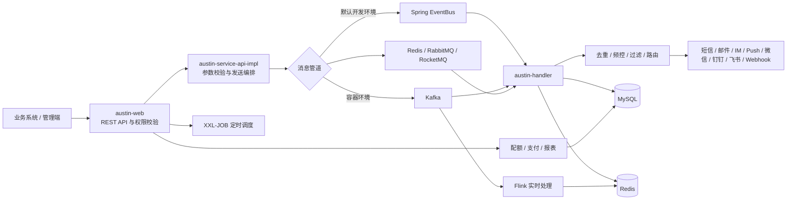

# Austin 多租户消息推送平台

Austin 是一个面向企业通知、业务触达和个人开发者场景的统一消息推送平台。项目将站内信、短信、邮件、Push、微信、企业微信、钉钉、飞书、支付宝小程序和通用 Webhook 等渠道收敛到统一的模板、发送、调度、消费、追踪和治理链路中。

本仓库在 Austin 原有消息平台能力上，进一步加入了多租户、用户与角色权限、配额计费、沙箱支付、月度报表、MQ Inbox 幂等重试以及个人开发者友好的 Mock 渠道，适合作为消息中台、通知中心或消息 SaaS 的后端基础工程。

> 当前仓库以 Java 后端为主。`austin/` 目录尚未包含可运行的前端源码；配置中的 `http://localhost:3000` 是为独立管理端预留的跨域来源。后端接口可以通过 Swagger 或其他 API 客户端访问。

## 项目解决什么问题

业务系统通常会分别接入短信、邮件、飞书机器人。随着渠道增多，模板管理、账号密钥、定时发送、失败重试、频控去重、发送追踪和成本核算会散落在各个系统里，最终形成大量重复代码和运维负担。

Austin 通过统一消息模型和可扩展 Handler 屏蔽不同供应商的差异，主要解决以下问题：

- 统一接入多种消息渠道，业务方只需要面向一套发送 API。
- 集中管理消息模板、渠道账号、变量内容和目标人群。
- 支持实时发送、批量发送、定时发送和消息撤回。
- 在发送链路中统一执行参数校验、夜间屏蔽、敏感词过滤、去重和流量控制。
- 通过消息队列解耦生产与消费，并通过 Inbox 机制提供消费幂等、租约、退避重试和人工重放能力。
- 按租户隔离用户、模板、渠道账号、发送记录、配额和报表数据。
- 提供配额预占、结算、退款、流水、告警、沙箱支付和月度对账报表能力。
- 使用 Flink、Redis 和日志链路支持实时数据处理与消息追踪。
- 为个人开发提供 Mock 短信、站内信、邮箱、飞书机器人和通用 Webhook，降低第三方资质门槛。

## 核心功能

### 消息能力

- 单条发送、批量发送、模板测试发送和消息撤回。
- 定时任务和人群文件批量推送。
- 消息模板、渠道账号、素材及发送记录管理。
- 内容去重、频次去重、敏感词过滤、夜间屏蔽和流量控制。
- 多供应商负载均衡和短信脚本路由。
- 全链路消息查询、短信回执及实时数据处理。

### 渠道能力

| 编码 | 渠道 | 当前默认策略 |
| --- | --- | --- |
| 10 | IM 站内信 | 默认启用，无需第三方账号 |
| 20 | 个推 Push | 支持，默认关闭 |
| 30 | 短信 | 默认启用，仅开放 `MockSmsScript` |  ✔️
| 40 | 邮件 | 默认启用，需通过环境变量配置 SMTP |   ✔️
| 50 | 微信服务号 | 支持，默认关闭 |
| 60 | 微信小程序 | 支持，默认关闭 |
| 70 | 企业微信 | 支持，默认关闭 |
| 80 | 钉钉群机器人 | 支持，默认关闭 |
| 90 | 钉钉工作通知 | 支持，默认关闭 |
| 100 | 企业微信机器人 | 支持，默认关闭 |
| 110 | 飞书群机器人 | 默认启用，使用前需配置 Webhook |  ✔️
| 120 | 支付宝小程序 | 支持，默认关闭 |
| 130 | 通用 Webhook | 默认启用，仅允许安全的 HTTPS 公网地址 |

默认开放渠道由 `AUSTIN_ENABLED_CHANNELS=10,30,40,110,130` 控制。修改该列表只会改变渠道可见性和发送权限，不会删除历史模板。

### SaaS 与可靠性能力

- 基于租户的数据隔离与会话身份传递。
- `ADMIN`、`OPERATOR`、`AUDITOR`、`USER` 四级角色权限控制。
- 配额账户、配额预占/结算/释放和不可变流水。
- Mock Payment 与 Stripe 测试模式支付适配。
- Billing Outbox 可靠事件投递和失败重放。
- MQ Consume Inbox 幂等消费、失败重试和死信管理。
- 按月生成用量、费用、付款、余额与配额流水报表。
- Flyway 版本化数据库迁移。

## 系统架构



典型发送流程：

1. 业务系统调用 `/send` 或 `/batchSend`。
2. 服务层校验租户、模板、渠道状态、参数和幂等键，并按需预占配额。
3. 消息进入选定的 MQ/EventBus 管道。
4. 消费端通过 Inbox 保证幂等，依次执行屏蔽、去重、敏感词、频控和发送动作。
5. 渠道 Handler 调用实际供应商或 Mock 实现，并记录结果、配额结算和追踪数据。
6. Flink、Redis、MySQL、Prometheus 等组件承担实时处理、状态存储、报表与监控。

## 技术栈

### 核心框架

| 分类 | 技术与版本 | 用途 |
| --- | --- | --- |
| 语言与构建 | Java 8 字节码、JDK 17 构建、Maven 3.9.x | 兼容旧运行环境，同时使用固定构建工具链 |
| Web 框架 | Spring Boot 2.5.6、Spring MVC | REST API 与应用装配 |
| 安全 | Spring Security、Spring Session Data Redis | 登录、Session、角色与接口权限 |
| 数据访问 | Spring Data JPA、HikariCP | 业务数据访问与连接池 |
| 数据库迁移 | Flyway | 管理 V1～V10 数据库结构演进 |
| 数据库 | MySQL 5.7、MySQL Connector/J 8.0.33 | 模板、用户、租户、账单、报表和可靠消息数据 |
| 缓存 | Redis 3.2 | Session、缓存、去重和链路状态 |
| 消息队列 | Kafka；可选 RabbitMQ、RocketMQ、Redis、EventBus | 消息生产消费解耦 |
| 流处理 | Flink 1.14.3 API、容器运行时 1.16.1 | 实时消息日志与数据处理 |
| 调度 | XXL-JOB 2.3.0 | 定时发送和任务调度 |
| 配置中心 | Nacos 2.1.0；可选 Apollo | 动态配置与规则配置 |
| 监控 | Spring Boot Actuator、Micrometer、Prometheus | 健康检查与指标采集 |
| 接口文档 | Springfox Swagger 3.0.0 / OpenAPI 3 | 在线接口调试 |
| 支付 | Stripe Java 33.2.0、Mock Payment | 测试模式配额购买 |
| 报表 | Apache POI 5.2.5 | 生成 Excel 月度报表 |
| 工具库 | Fastjson2 2.0.60、Hutool 5.7.15、Guava 31.0.1、OkHttp 4.9.2 | JSON、通用工具、缓存结构和 HTTP 调用 |
| 部署 | Docker、Docker Compose | 一键编排应用及中间件 |

> 注意：项目要求使用 JDK 17 和 Maven 3.9.x **进行构建**，生成的业务代码目标版本仍为 Java 8。详细原因见 [`docs/build-toolchain.md`](docs/build-toolchain.md)。

## 模块说明

| 模块 | 主要职责 |
| --- | --- |
| `austin-web` | Spring Boot 启动入口、REST Controller、Swagger、健康检查和 Web 层编排 |
| `austin-auth` | 用户、登录、Redis Session、角色权限与租户身份 |
| `austin-billing` | 配额账户、流水、预占结算、支付、告警与 Billing Outbox |
| `austin-report` | 月度报表任务、数据装配、Excel 生成、存储与下载 |
| `austin-service-api` | 对业务方暴露的发送、撤回和追踪接口定义及 DTO |
| `austin-service-api-impl` | 发送 API 实现、参数校验、业务编排和消息入队 |
| `austin-handler` | MQ 消费、Inbox、去重、频控、过滤和各渠道 Handler |
| `austin-cron` | XXL-JOB 定时任务、人群文件处理和定时发送 |
| `austin-stream` | Flink 实时流任务，消费追踪日志并写入 Redis |
| `austin-data-house` | Flink Table/Hive 离线数仓任务 |
| `austin-support` | 数据访问、MQ 适配、配置中心、日志、线程池及公共基础设施 |
| `austin-common` | 公共枚举、常量、消息模型、账号模型和流水线抽象 |

## 默认端口

### 根目录 Docker Compose

| 服务 | 宿主机端口 | 容器端口 | 访问方式/说明 |
| --- | ---: | ---: | --- |
| Austin 后端 | `7777` | `7777` | `http://localhost:7777` |
| MySQL | `3306` | `3306` | Austin、Nacos、XXL-JOB 数据库 |
| Redis | `6379` | `6379` | Session、缓存与去重 |
| ZooKeeper | `2181` | `2181` | Kafka 协调服务 |
| Kafka | `9092` | `9092` | 业务、撤回和追踪 Topic |
| XXL-JOB 控制台 | `18080` | `8080` | `http://localhost:18080/xxl-job-admin` |
| Nacos 控制台 | `8848` | `8848` | `http://localhost:8848/nacos` |
| Nacos gRPC | `9848`、`9849` | 同端口 | Nacos 2.x 客户端通信 |
| Flink Dashboard | `18081` | `8081` | `http://localhost:18081`，仅 `docker-compose.yml` 包含 |

### 不同启动 Profile

| 启动方式 | Profile | 后端端口 | MQ | 配置中心/调度 |
| --- | --- | ---: | --- | --- |
| 直接运行默认配置 | `dev` | `7778` | Spring EventBus | Nacos、Apollo、XXL-JOB 默认关闭 |
| Dockerfile / Compose | `test` | `7777` | Kafka | Nacos、XXL-JOB、Hades 开启 |
| macOS 本地配置 | `mac` | `7777` | Spring EventBus | Nacos、XXL-JOB、Hades 开启 |

XXL-JOB 执行器默认端口为 `6666`，但根 Compose 未将其映射到宿主机。可选组件的独立编排文件位于 `doc/docker/`，它们的端口以各自 Compose 文件为准。

## 默认账号与密码

以下都是仓库中用于本地开发或演示的默认值，不是生产凭据：

| 服务 | 用户名 | 默认密码 | 生效范围 |
| --- | --- | --- | --- |
| Austin 管理员 | `dev-user` | `admin123` | 仅根目录 `docker-compose.yml` 默认首次启动时创建 |
| MySQL | `root` | `root123_A` | 根 Compose 与项目默认数据库配置 |
| Redis | 无用户名 | `austin` | `doc/docker/redis/redis.conf` |
| XXL-JOB | `admin` | `123456` | XXL-JOB 控制台与客户端配置 |
| Nacos | `nacos` | `nacos` | Nacos 客户端/控制台默认值 |
| Kafka / ZooKeeper / Flink | 无 | 无 | 本地 Compose 未开启认证 |

Austin 管理员需要特别注意：

- 普通应用配置默认 `AUSTIN_AUTH_BOOTSTRAP_ENABLED=false`，不会自动创建用户。
- 根目录 `docker-compose.yml` 将其默认设为 `true`，并使用 `dev-user/admin123` 创建首个管理员。
- 初始化器只在用户名不存在时创建账户，不会在后续启动时重置现有密码。
- `docker-compose-deploy.yml` 没有注入管理员初始化变量，新环境部署前必须显式提供安全的初始化密码。

生产部署必须修改上述密码、关闭管理员自动初始化、限制中间件端口访问，并为 Kafka、Flink 等组件配置认证。SMTP 授权码、飞书 Webhook、Stripe Key 等真实密钥只应通过环境变量或密钥管理服务注入。仓库根目录的 `.env` 已被 `.gitignore` 忽略，其中的私密值不应写入 README、日志或提交到 Gitee。

## 快速开始

### 环境要求

- JDK 17（构建使用）
- Maven 3.9.x
- Docker Engine 与 Docker Compose v2
- 建议至少 4 GB 可用内存

确认环境：

```bash
java -version
mvn -version
docker version
docker compose version
```

### 方式一：Docker Compose 完整启动

1. 克隆项目：

```bash
git clone https://gitee.com/leaving-uu/austin.git
cd austin
```

2. 构建 Compose 需要的后端和 Flink Jar：

```bash
mvn -pl austin-web,austin-stream -am clean package -DskipTests
```

3. 建议在首次启动前通过环境变量覆盖开发密码：

```bash
export AUSTIN_AUTH_BOOTSTRAP_ENABLED=true
export AUSTIN_AUTH_BOOTSTRAP_USERNAME=dev-user
export AUSTIN_AUTH_BOOTSTRAP_PASSWORD='请替换为至少8位的强密码'
export AUSTIN_AUTH_BOOTSTRAP_DISPLAY_NAME='Austin 管理员'
```

4. 启动全部组件：

```bash
docker compose up -d --build
```

5. 查看状态和日志：

```bash
docker compose ps
docker compose logs -f austin
```

6. 验证服务：

```bash
curl http://localhost:7777/actuator/health
```

常用入口：

- Swagger：`http://localhost:7777/swagger-ui/index.html`
- 健康检查：`http://localhost:7777/actuator/health`
- XXL-JOB：`http://localhost:18080/xxl-job-admin`
- Nacos：`http://localhost:8848/nacos`
- Flink：`http://localhost:18081`

### 方式二：最小化本地开发

默认 `dev` Profile 使用进程内 Spring EventBus，不依赖 Kafka、Nacos 和 XXL-JOB，只需 MySQL 与 Redis：

```bash
docker compose up -d austin-mysql austin-redis
mvn -pl austin-web -am package -DskipTests
```

首次启动时创建本地管理员，并将容器主机名覆盖为 `127.0.0.1`：

```bash
export AUSTIN_AUTH_BOOTSTRAP_ENABLED=true
export AUSTIN_AUTH_BOOTSTRAP_USERNAME=dev-user
export AUSTIN_AUTH_BOOTSTRAP_PASSWORD='请替换为至少8位的强密码'

java -jar austin-web/target/austin-web-0.0.1-SNAPSHOT.jar \
  --spring.profiles.active=dev \
  --austin.database.ip=127.0.0.1 \
  --austin.redis.ip=127.0.0.1
```

此方式的后端地址是 `http://localhost:7778`，Swagger 地址是 `http://localhost:7778/swagger-ui/index.html`。

### 登录接口示例

```bash
curl -i -c cookie.txt \
  -H 'Content-Type: application/json' \
  -d '{"username":"dev-user","password":"你的初始化密码"}' \
  http://localhost:7777/auth/login

curl -b cookie.txt http://localhost:7777/auth/me
```

项目使用服务端 Session，客户端需要在后续请求中携带登录返回的 Cookie。

## 数据库初始化与升级

新环境只需要创建空的 `austin` 数据库，应用启动后 Flyway 会按顺序执行各模块中的 V1～V10 迁移。不要再对新库手工执行历史文件 `doc/sql/austin.sql`。

对于已有 Austin 数据库：

1. 先完成数据库备份并核对旧表结构。
2. 仅在第一次受控升级时设置 `AUSTIN_FLYWAY_BASELINE_ON_MIGRATE=true`。
3. 确认生成 `flyway_schema_history` 后立即恢复为 `false`。

完整说明见 [`docs/database-migrations.md`](docs/database-migrations.md)。生产环境的大表租户字段迁移可能锁表，应提前评估并安排变更窗口。

## 常用配置

### 管理员与跨域

| 环境变量 | 默认值 | 说明 |
| --- | --- | --- |
| `AUSTIN_AUTH_BOOTSTRAP_ENABLED` | 应用 `false`；开发 Compose `true` | 是否初始化管理员 |
| `AUSTIN_AUTH_BOOTSTRAP_USERNAME` | `dev-user` | 初始化用户名 |
| `AUSTIN_AUTH_BOOTSTRAP_PASSWORD` | 应用无默认值 | 初始化密码，至少 8 位 |
| `AUSTIN_AUTH_BOOTSTRAP_DISPLAY_NAME` | `Austin 管理员` | 管理员显示名 |
| `AUSTIN_AUTH_BOOTSTRAP_TENANT_ID` | `1` | 初始管理员所属租户 |
| `AUSTIN_ADMIN_ORIGIN` | `http://localhost:3000` | 独立管理端允许的 Origin |

### 渠道与 SMTP

| 环境变量 | 默认值 | 说明 |
| --- | --- | --- |
| `AUSTIN_ENABLED_CHANNELS` | `10,30,40,110,130` | 启用的渠道编码 |
| `AUSTIN_ENABLED_SMS_SCRIPTS` | `MockSmsScript` | 允许使用的短信实现 |
| `AUSTIN_SMTP_HOST` | 空 | SMTP 主机 |
| `AUSTIN_SMTP_PORT` | 空 | SMTP 端口 |
| `AUSTIN_SMTP_USER` | 空 | SMTP 登录账号 |
| `AUSTIN_SMTP_FROM` | 空 | 发件人地址 |
| `AUSTIN_SMTP_AUTH_CODE` | 空 | SMTP 授权码，不是网页登录密码 |
| `AUSTIN_SMTP_SSL_ENABLED` | `true` | 是否启用 SSL |
| `AUSTIN_SMTP_STARTTLS_ENABLED` | `false` | 是否启用 STARTTLS |
| `AUSTIN_FEISHU_ROBOT_ENABLED` | `false` | 是否启用环境变量飞书机器人 |
| `AUSTIN_FEISHU_ROBOT_WEBHOOK` | 空 | 飞书官方 HTTPS Webhook |

邮箱、飞书机器人、Mock 短信及通用 Webhook 的配置示例见 [`docs/personal-channel-setup.md`](docs/personal-channel-setup.md)。

### 配额、支付与报表

| 环境变量 | 默认值 | 说明 |
| --- | --- | --- |
| `AUSTIN_BILLING_QUOTA_ENFORCEMENT_ENABLED` | `false` | 是否强制执行配额校验 |
| `AUSTIN_MOCK_PAYMENT_ENABLED` | `false` | 是否启用开发环境 Mock Payment |
| `AUSTIN_STRIPE_ENABLED` | `false` | 是否启用 Stripe 测试模式 |
| `AUSTIN_STRIPE_API_KEY` | 无 | Stripe 测试 API Key |
| `AUSTIN_STRIPE_WEBHOOK_SECRET` | 无 | Stripe 测试 Webhook Secret |
| `AUSTIN_REPORT_STORAGE_LOCAL_BASE_DIR` | 系统临时目录下的 `austin-reports` | 本地报表目录 |

当前支付边界为沙箱和 Stripe 测试模式，不允许通过单纯配置切换为真实收款。详细策略见 [`docs/saas-payment-policy.md`](docs/saas-payment-policy.md)。

## 消息管道与 Topic

支持的消息管道包括：

- `eventBus`：轻量单机模式，适合本地开发。
- `kafka`：默认容器模式，适合异步解耦和 Flink 实时处理。
- `rabbitMq`、`rocketMq`、`redis`：按需部署并修改 `austin.mq.pipeline`。

根 Compose 自动创建以下 Kafka Topic：

| Topic | 用途 |
| --- | --- |
| `austinBusiness` | 正常消息发送 |
| `austinRecall` | 消息撤回 |
| `austinTraceLog` | 链路追踪日志 |

## API 入口

| 接口 | 说明 |
| --- | --- |
| `POST /auth/login` | 用户登录 |
| `GET /auth/me` | 获取当前用户、租户和权限 |
| `POST /send` | 单条消息发送 |
| `POST /batchSend` | 批量消息发送 |
| `POST /recall` | 消息撤回 |
| `/messageTemplate/**` | 模板新增、查询、复制、测试、启停和撤回 |
| `/account/**` | 渠道账号与可用性管理 |
| `/channel/**` | 渠道列表 |
| `/trace/**` | 消息链路查询 |
| `/inbox/**` | 站内信查询、已读和删除 |
| `/billing/**` | 套餐、支付、配额和报表 |
| `/admin/mq/inbox/**` | MQ 死信查询与人工重放 |
| `/admin/billing/outbox/**` | Billing Outbox 查询与重放 |
| `/actuator/**` | 健康检查与监控指标 |

完整请求参数和响应模型请在服务启动后查看 Swagger。除登录、健康检查和支付回调等白名单接口外，业务接口均受 Session 和角色权限保护。

## 构建与测试

运行主应用、发送链路和 Flink 模块的单元测试与构建校验：

```bash
mvn -pl austin-web,austin-stream -am verify
```

运行依赖 Docker 的 MySQL 集成测试：

```bash
mvn -Pintegration-test verify
```

只验证 Web 模块及其依赖：

```bash
mvn -pl austin-web -am verify
```

`austin-data-house` 是独立的旧版 Hive 数仓模块，其传递依赖 `org.pentaho:pentaho-aggdesigner-algorithm:5.1.5-jhyde` 来自已被现代 Maven 默认拦截的 HTTP 仓库，因此未配置可信 HTTPS 镜像时，直接执行根项目 `mvn package` 或 `mvn verify` 会在该模块的依赖解析阶段失败。该模块不是根 Compose 启动 Austin 后端和 Flink 实时任务所必需的；需要构建数仓任务时，请先在企业 Maven 仓库中代理并审核该依赖，不要关闭 Maven 的 HTTP 安全拦截。

## 安全与生产部署建议

- 不要将 `.env`、SMTP 授权码、Webhook、AccessKey、Stripe Key 或账号 JSON 提交到 Git。
- 首次启动后关闭 `AUSTIN_AUTH_BOOTSTRAP_ENABLED`，并删除 Shell 历史中的明文密码。
- 修改 MySQL、Redis、XXL-JOB、Nacos 等全部默认密码。
- 不要把 `3306`、`6379`、`9092`、`2181`、`8848`、`18080` 等管理和中间件端口直接暴露到公网。
- 为 Kafka、Nacos、Flink 和监控系统启用认证、TLS 与最小权限网络策略。
- 生产环境使用受控的密钥管理服务，不在 Compose 文件中保留明文凭据。
- 对外部署时在 Austin 前增加 HTTPS 网关，并配置可信的 CORS Origin、限流、审计和告警。
- Mock 短信与 Mock Payment 仅用于开发/测试，生产 Profile 不应注册或启用。
- 真实短信、微信、企业微信等渠道通常需要企业资质、签名和模板审核。

## 常见问题

### 启动后访问 7777 没有响应

直接运行默认 `dev` Profile 时端口是 `7778`；只有 Docker `test` Profile 和 `mac` Profile 使用 `7777`。先查看启动日志中的 `Swagger Url` 确认实际端口。

### 启动后没有管理员账号

应用配置默认不创建管理员。设置 `AUSTIN_AUTH_BOOTSTRAP_ENABLED=true` 和一个至少 8 位的 `AUSTIN_AUTH_BOOTSTRAP_PASSWORD` 后首次启动。已有同名用户时不会覆盖密码。

### 为什么没有管理页面

当前仓库没有实际前端源码，`localhost:3000` 只是独立管理端的默认来源配置。请使用 Swagger/API 客户端，或单独接入与接口契约匹配的管理端。

### 为什么真实短信无法发送

默认只开放 `MockSmsScript`。真实短信需要将对应脚本加入 `AUSTIN_ENABLED_SMS_SCRIPTS`，创建完整渠道账号，并完成供应商资质、签名和模板审核。

### Flyway 提示非空数据库没有历史表

不要直接开启自动接管。先备份并确认是兼容的旧 Austin 数据库，再按 [`docs/database-migrations.md`](docs/database-migrations.md) 执行一次受控 baseline。

## 项目文档

- [`docs/personal-channel-setup.md`](docs/personal-channel-setup.md)：个人开发者渠道配置
- [`docs/database-migrations.md`](docs/database-migrations.md)：数据库迁移与旧库升级
- [`docs/build-toolchain.md`](docs/build-toolchain.md)：JDK 与 Maven 构建约束
- [`docs/saas-payment-policy.md`](docs/saas-payment-policy.md)：SaaS 支付边界与配额策略
- [`doc/INSTALL.md`](doc/INSTALL.md)：各中间件独立安装参考
- [`doc/uml/AustinCoreClassDiagram.drawio`](doc/uml/AustinCoreClassDiagram.drawio)：核心类图源文件

## 参与贡献

欢迎通过 Gitee Issue 提交问题或建议。贡献代码时建议遵循以下流程：

1. 从最新主分支创建功能分支。
2. 保持改动边界清晰，并补充必要的单元测试或集成测试。
3. 确认受影响模块的 `mvn verify` 通过，且没有提交任何真实凭据或本地文件。
4. 提交 Pull Request，并说明背景、方案、兼容性和验证结果。

## 开源协议

本项目采用 [Apache License 2.0](LICENSE) 开源协议。

如用于生产环境，请根据业务规模完成容量评估、安全加固、渠道合规、数据保护、监控告警和灾备演练。
